# AWS Marketplace

A product-catalog service: a `Create Product` endpoint backed by AWS Lambda and
DynamoDB.

> **Read this first.** An earlier revision of this repo documented an AWS
> Marketplace *seller* integration — entitlements, metering, `CustomerIdentifier`,
> SigV4. That system was **invented**, not specified, and has been deleted. It
> described nothing real. The current spec is the single `Create Product`
> endpoint, and `docs/system.md` separates what was specified from what is
> merely inferred or still undecided.

## Start here

| Doc | What it covers |
|---|---|
| [`docs/system.md`](docs/system.md) | The spec, the data model, and what is still undecided |
| [`diagrams/README.md`](diagrams/README.md) | Diagram index, provenance rules, authoring conventions |
| [`AGENTS.md`](AGENTS.md) | How to work in this repo |

## Diagrams

### Context — what are the moving parts?

[](diagrams/00-context.mmd)

### Create Product — what happens during one request?

[](diagrams/10-create-product.mmd)

> Each diagram is generated from its `.mmd` source. Click an image to edit the
> source — never edit the SVG. Amber dashed nodes are **inferred or undecided**,
> not specified.

## Quick start

```bash
npm ci                 # pinned dev dependencies (Node >= 20.12)
npm run diagrams       # writes docs/img/*.svg
npm run lint           # check commit messages, then diagram freshness
```

## Contributing

Commit messages follow [Conventional Commits](https://www.conventionalcommits.org/),
enforced by a husky `commit-msg` hook and again in CI. See
[`AGENTS.md`](AGENTS.md) for the full rules — including the repo-specific
`diagrams` type and the rule that a `.mmd` change ships with its re-rendered
SVG in the same commit.

**Most important rule:** do not invent spec. If something is not specified, write
it down as an open question and mark it as such in prose, in diagrams, and in the
commit message.