# AWS Marketplace Study

Working notes on integrating a SaaS product with AWS Marketplace — entitlement
resolution and usage metering.

The diagrams are Mermaid text, editable by hand and by agent, rendered to SVG
in CI. See [`diagrams/README.md`](diagrams/README.md) for conventions and
[`AGENTS.md`](AGENTS.md) for the editing contract.

## Start here

| Doc | What it covers |
|---|---|
| [`docs/system.md`](docs/system.md) | Scope, billing models, API surface, constraints, open questions |
| [`diagrams/README.md`](diagrams/README.md) | Diagram index + authoring conventions |
| [`AGENTS.md`](AGENTS.md) | How to work in this repo |

## Rendered diagrams

### Context — who talks to what, and what do we own?

[](diagrams/00-context.mmd)

### Entitlement — how does a request become an authorized request?

[](diagrams/10-entitlement.mmd)

### Metering — how does usage become revenue?

[](diagrams/20-metering.mmd)

> Each diagram is generated from its `.mmd` source. Click an image to edit the
> source — never edit the SVG.

## Quick start

```bash
npm ci                 # pinned dev dependencies (Node >= 20.12)
npm run diagrams       # writes docs/img/*.svg
npm run lint           # check commit messages, then diagram freshness
```

## Contributing

Commit messages follow [Conventional Commits](https://www.conventionalcommits.org/),
enforced by a husky `commit-msg` hook and again in CI. See
[`AGENTS.md`](AGENTS.md) for the full rules — including the repo-specific
`diagrams` type and the rule that a `.mmd` change ships with its re-rendered
SVG in the same commit.